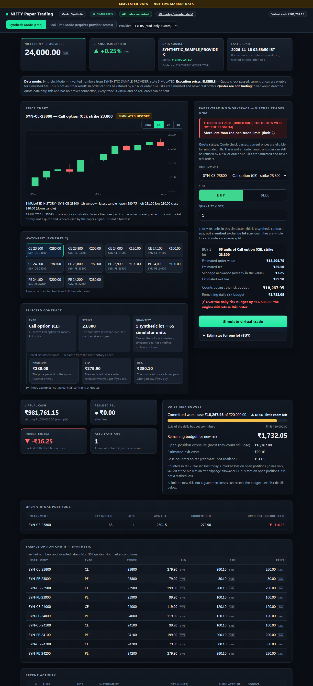
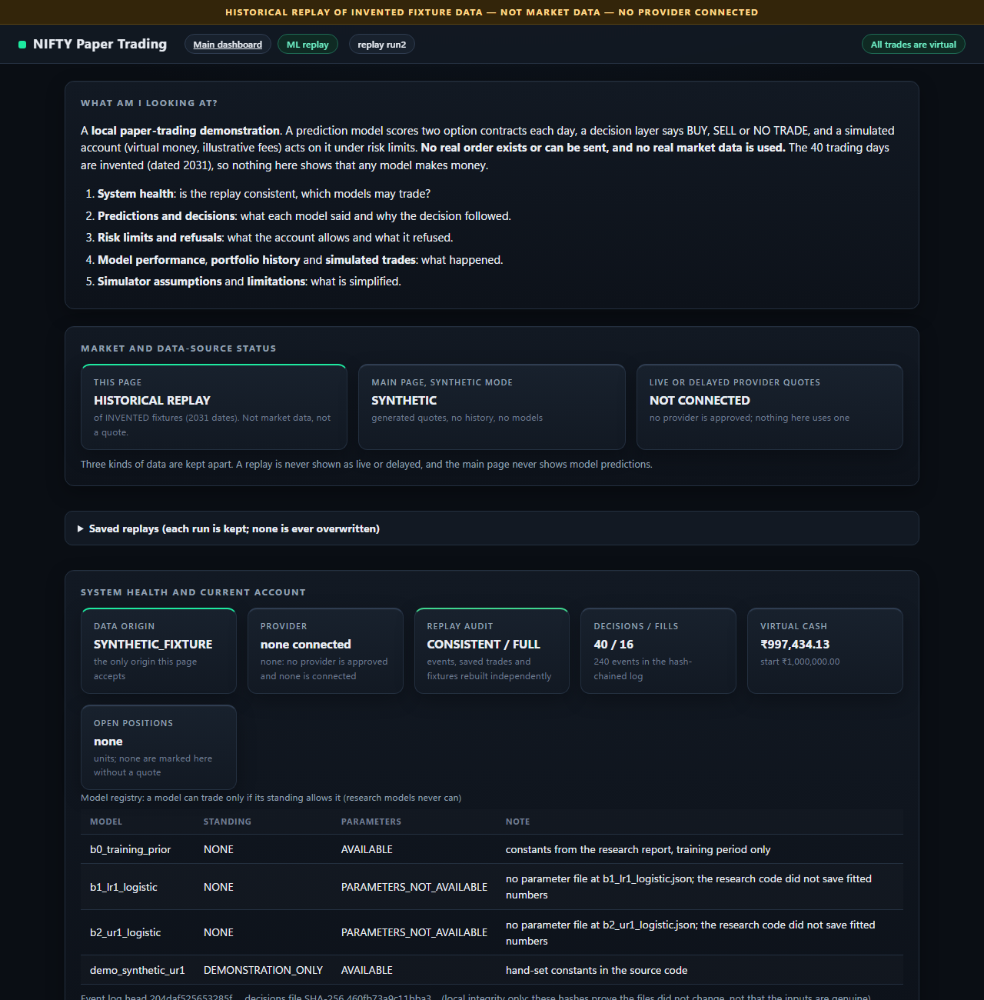
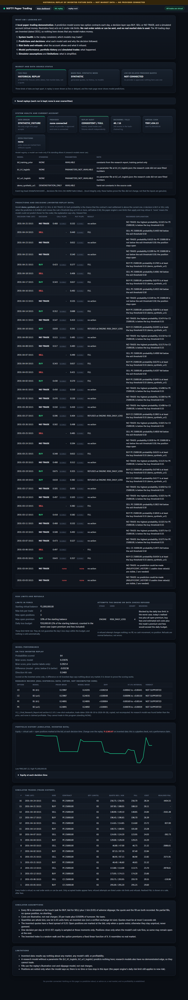
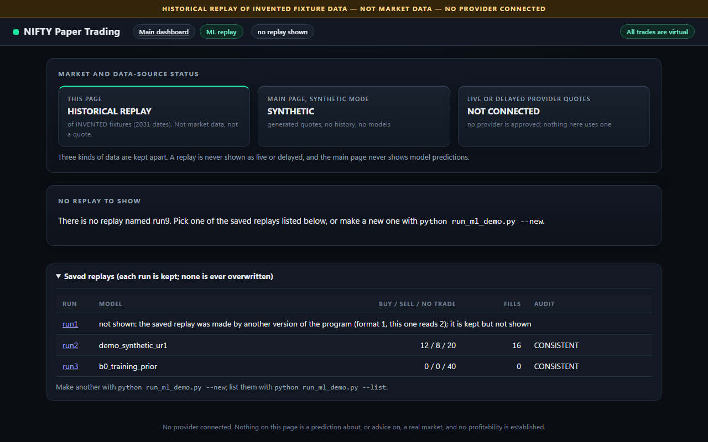

# NIFTY Options ML Paper-Trading

A **simulation-only** project in two parts:

1. **`research/`**: a frozen, one-shot research study (V4.7 to V5.1) on NSE NIFTY index-option settlement data. It asked whether two simple lagged-return features predict the next settlement direction better than a baseline. **It found no predictive edge.**
2. **`application/`**: a local Python paper-trading platform (standard library only) that connects a prediction layer to a risk-controlled paper-trading engine, a replay/audit pipeline and a browser dashboard. It runs on **invented data** and places **no real orders**.

> **No real orders are placed. No broker is connected. No real market data or credentials are used by the application. No profitability and no predictive edge are claimed.**

## Quick Start (Windows)

The recommended way to run the application is to **double-click a launcher**. No commands needed.

### Start the dashboard

1. Download or clone this repository.
2. Keep `NIFTY_PaperTrading.exe`, `Stop_Dashboard.exe` and the `application` folder **together in the same project folder** (as they are here).
3. Double-click **`NIFTY_PaperTrading.exe`**.
4. Wait a few seconds while it starts. Your browser then opens the ML replay page at <http://127.0.0.1:8765/ml>.
5. The main dashboard is on the same server at <http://127.0.0.1:8765/>.

Running it a second time does not start a second server; it just opens the browser again.

### Stop the dashboard

Double-click **`Stop_Dashboard.exe`**. Closing the browser tab does **not** stop the server; it keeps running in the background until you stop it.

### Prerequisites and limitations

- **Python 3.12 or newer** must be installed and available on the PATH (python.org; tick "Add python.exe to PATH"). The Microsoft Store shortcut does not count.
- The two `.exe` files are **small launchers**, not a bundled copy of Python or of the application. They only start and stop `python run_ml_demo.py` on your own PC.
- The executables are **unsigned**, so Windows SmartScreen may show a warning the first time. Choose "More info", then "Run anyway", only if you trust where you got the files. You can rebuild them from source (see [launcher/README.md](launcher/README.md)).
- The application runs **locally in Synthetic Mode on invented data**. No broker connection, no real market data and no real-money trading are involved.
- The **first launch creates the application's local data folder** (`application/data/`, ignored by git) and an initial synthetic replay (`run1`). Later launches show the saved replay unchanged.
- Launcher source, build instructions and troubleshooting: [launcher/README.md](launcher/README.md).
  
## What the results actually show

- **Research (real NSE settlement data, frozen protocol, evaluated once):** on the untouched window 2026-06-30 to 2026-09-28, neither model beat the training-rate prior for calls or puts. All four Brier differences were slightly positive or about zero and every 97.5% interval included 0 (**not supported**). One call-side relationship (`lr1`) was borderline unstable over time (p = 0.0235 against a 0.025 threshold). Absence of a detected effect is not proof that none exists. Details: [docs/RESULTS.md](docs/RESULTS.md) and `research/V5.1/V5_1_Final_Research_Report.md`.
- **Application (invented 2031 data):** a demonstration model with **hand-set, untuned parameters** drives the pipeline end to end (40 invented days: 12 BUY, 8 SELL, 20 NO TRADE, 16 simulated fills). Its numbers on invented data say nothing about any market or any model's skill. The research models are barred from trading by design (standing `NONE`).

## Repository map

```
README.md                  this file
.gitignore, .gitattributes repository rules (research/ is stored byte-for-byte, no line-ending conversion)
NIFTY_PaperTrading.exe     double-click launcher: starts the dashboard (see Quick Start)
Stop_Dashboard.exe         double-click launcher: stops the dashboard
launcher/                  launcher source (C#), build script and README
application/               the runnable platform (self-contained: its own README, pyproject.toml, tests, docs)
  src/niftypaper/          paper engine, historical replay + audit, ML integration, dashboard, safety scanner
  tests/                   904 automated tests (+ synthetic fixtures)
  config/  tools/  docs/   configuration, command-line tools, detailed milestone records
  run_ml_demo.py  run_dashboard.py  tools/replay_fixture_demo.py
research/                  frozen research (see research/README.md)
  V5.1/                    frozen protocol, final report, evaluation outputs, manifests
  V5.0/                    stability-study outputs
  scripts/                 the research code (the frozen protocol hashes these files)
  notebooks/               V4.8, V4.9, V5.0 notebooks
  reports/                 stage READMEs
  reproducibility/         hashes, what was left out and why, how to re-acquire data
docs/                      project-level documentation (index in docs/README.md)
screenshots/               four screenshots of the running application (invented data)
```

## How the research connects to the application

The application re-implements the **definitions** from the research (`lr1` = ln(settle[t-1]/settle[t-2]); `ur1` = underlying[t-1]/underlying[t-2] - 1; the training-rate baseline) and **copies the V5.1 result as a record** shown on the dashboard. It does **not** read the research data, retrain, or recompute anything from it. The fitted parameters of the research models were never saved, so they cannot be loaded; the registry therefore marks them `NONE` (display only, never tradable). See [docs/ML_METHODOLOGY.md](docs/ML_METHODOLOGY.md).

## Manual Launch (Python)

An alternative to the launchers above, for those who prefer PowerShell. Requires **Python 3.12 or newer** (developed and tested on 3.14.6). Nothing to install: the application uses only the standard library.

```powershell
cd application
python run_ml_demo.py                      # makes a replay on invented data if none exists, serves http://127.0.0.1:8765/ml
python run_dashboard.py                    # the normal dashboard only (Synthetic Mode): http://127.0.0.1:8765/
python tools/replay_fixture_demo.py        # fixed fixture replay on invented, labelled data (no network, no real data)
```

Stop a server with Ctrl+C. The demo guide is [application/docs/ML_DEMO_GUIDE.md](application/docs/ML_DEMO_GUIDE.md).

## Run the tests and the safety scan

The test suite and the safety scan use `git` to list files, so run them **inside a git repository** (clone this repository, or `git init` and commit first).

```powershell
cd application
python -B -W error::ResourceWarning -m unittest discover -s tests -t .
$env:PYTHONPATH = "src"; python -B -m niftypaper.safety.scan --root . --include-untracked
```

Expected: 904 tests OK with 5 skipped (the JavaScript chart tests need Node.js), and the scan reports 0 findings. The scan is pattern-based and does not prove the absence of secrets. The scan covers `application/` only (it fails closed on binary files, so the screenshots are kept outside it).

## Research: what is included and how to verify it

Included: the frozen protocol, final report, evaluation outputs, manifests, code and notebooks, all **byte-identical** to the originals (SHA-256 list in `research/reproducibility/SHA256SUMS.txt`). **Not included:** NSE raw files and NSE-derived datasets (see Data provenance). Re-running the one-shot evaluation is blocked by design and was not done. See [research/README.md](research/README.md).

## Data provenance (read this)

| Data | Where | What it is |
|---|---|---|
| Application demo data | `application/src/niftypaper/ml/fixtures.py`, `application/tests/fixtures/` | **Invented** (dates in 2031). Labelled `SYNTHETIC_FIXTURE` everywhere; the replay runner refuses any other origin. |
| Application live-like quotes | dashboard main page | **Generated** by a synthetic provider. Never model input. |
| Provider data | not connected | No provider is approved. No credentials exist in the repository. |
| Research data | **not in this repository** | Real NSE end-of-day F&O bhavcopy and contract-wise exports, 2025-10 to 2026-09. NSE's terms restrict redistribution and simulation use, so the data files are excluded. Their names and SHA-256 hashes are in the manifests under `research/V5.1/` and `research/V5.0/`. |

NSE's terms of use (checked 2026-10-27, recorded in `application/config/historical_data_sources.json`) prohibit use of the data for "gaming, virtual trading or simulation activities" unless NSE agrees in writing. For that reason the application never uses NSE data. This is not legal advice. More: [docs/DATA_PROVENANCE.md](docs/DATA_PROVENANCE.md).

## Screenshots

All screenshots below show **invented synthetic data**, clearly labelled in the application. They are demonstrations of the simulator, not real market results.

### Main Dashboard — Synthetic Mode



### ML Replay Page — Overview



### ML Replay Page — Full View



### Unknown Saved Replay — Error State



## Limitations

Invented data only; one decision per day; no stop rule; lot size and tick size are illustrative; JSONL files rather than a database; no CI; the research covers one expiry and two single-feature models on end-of-day settlements that are not executable prices; manual browser click-through (sell, duplicate submit, restart) was not performed, only automated tests. Full list: [docs/LIMITATIONS.md](docs/LIMITATIONS.md).

## Future work

Obtain written data permission before any real-data replay; add a real-data origin class with ingest tests; pre-registered forward evaluation on new data; intraday features; continuous integration; a license decision by the owner (none has been chosen).

## License

**No license has been chosen.** All rights are reserved by default until the owner adds one.
