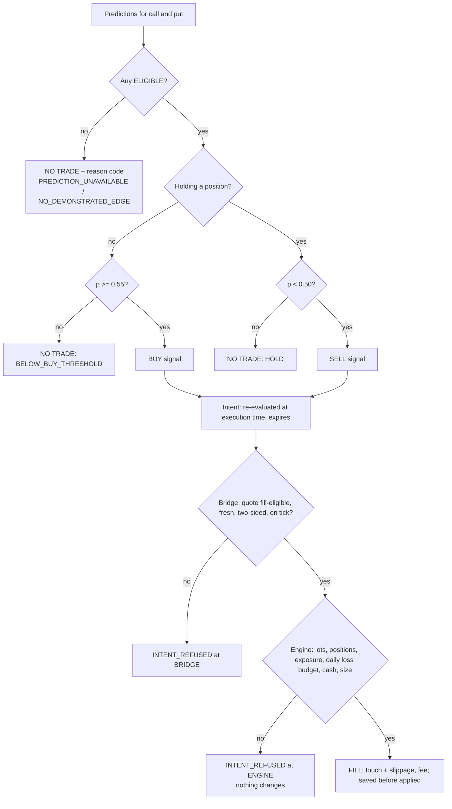

# Architecture

Everything runs locally on the Python standard library. No provider is connected; the ML path runs on invented fixture data. Module names below are real (`src/niftypaper/...`). Diagrams use Mermaid (rendered by GitHub) with a plain-text twin.

## 1. System overview

```mermaid
flowchart LR
  F[Invented fixtures<br/>ml/fixtures.py] --> I[Ingest + manifest hashes<br/>historical/ingest.py]
  I --> G[Point-in-time gate<br/>historical/gate.py]
  G --> FE[Features ur1, lr1<br/>ml/features.py]
  FE --> P[predict()<br/>ml/predict.py]
  P --> D[Decision layer<br/>ml/strategy.py]
  D --> IN[Intent conversion<br/>strategy/intents.py]
  IN --> B[Bridge<br/>historical/bridge.py]
  B --> E[Paper engine + risk limits<br/>paper/engine.py]
  E --> S[(Append-only account<br/>paper/store.py)]
  E --> L[(Hash-chained event log)]
  D --> DJ[(decisions.jsonl)]
  S --> SUM[summary.json<br/>ml/session.py]
  L --> SUM
  DJ --> SUM
  SUM --> UI[Dashboard /ml<br/>dashboard/ml_page.py]
  SYN[Synthetic quote generator<br/>dashboard/sample_data.py] --> MAIN[Dashboard /<br/>dashboard/render.py]
  MAIN --> E2[Paper engine, synthetic account]
```

```
fixtures -> ingest -> point-in-time gate -> features -> predict() -> decision -> intent -> bridge -> paper engine -> account + event log
                                                                      |                                              |
                                                                 decisions.jsonl ---------> summary.json <-----------+--> /ml page
synthetic quotes (live-like, no history, no models) -> main page -> paper engine (separate synthetic account)
```

Two data paths are never mixed: the **replay path** (above, invented fixtures, account `replay_synthetic_ml_demo`) and the **synthetic live-like path** (main page, account `paper_synthetic`). A provider path exists as read-only code behind fail-closed gates but is not connected (no approved data source).

## 2. ML prediction flow

1. `PointInTimeView` exposes only records whose `available_at` is not after the replay clock (day-level records become available at the end of their trading date).
2. `features.compute()` takes the two newest visible values (index closes for `ur1`, contract settlements for `lr1`) and returns a value or a reason code (`INSUFFICIENT_HISTORY`, `STALE_INPUT`, `GAPPED_SERIES`, `BELOW_PRICE_FLOOR`, `BAD_RECORD`). Nothing is filled in.
3. `predict(model, view, contract)` returns a `Prediction`: model id, probability that the contract's next settlement is above the current one, inputs with availability times, provenance and a data label, `data_observed_through`, and a status: `ELIGIBLE`, `DISPLAY_ONLY` or `UNAVAILABLE`.
4. The model registry (`ml/models.py`) gives each model a *standing*. Research models (B0 prior, B1, B2) have standing `NONE`: they can be displayed, never traded. The demonstration model has `DEMONSTRATION_ONLY` and is confined to synthetic-fixture origin.

## 3. Decision and paper-execution flow



Every decision (including NO TRADE) is written to `decisions.jsonl` with its reason, a sentence of explanation and the predictions it rested on. A refused intent changes no cash, position or ledger.

## 4. Persistence and audit flow

* **Account:** `JsonlStore` appends each accepted trade before the engine applies it; a header binds the file to its account and starting balance. On restart the engine rebuilds cash, positions and the day's risk from the file. A damaged or foreign file locks trading rather than starting blank. One writer at a time (lock file).
* **Replay:** `ml/session.py` builds a run in `<run>.partial`, writes `summary.json` last and renames to `runN`; an interrupted run leaves no result. Runs are never overwritten.
* **Audit:** `historical/audit.py` rebuilds the books from the event log, saved trades and fixtures and reports `CONSISTENT` / `FULL`; the event log is hash-chained (`eventchain.py`) and can be anchored (`anchor.py`).
* **Reproducibility:** identical fixtures, model and settings give identical decision, event-log and plan hashes (tested).

## 5. Dashboard flow

* `dashboard/server.py` (the only module importing `http`) binds to 127.0.0.1 only, checks Host and Origin, and accepts only two POSTs (`/mode`, `/paper/trade`) protected by a per-run form key plus a one-time form id (duplicate submissions are ignored with a visible reason). Routes: `/`, `/ml`, `/ml?run=ID`, `/api/snapshot`, `/api/ledger`, `/api/ml`.
* `/ml` only reads a run's `summary.json` and `decisions.jsonl`. A summary that is not labelled invented fixture data with no provider, or that is in another format, is listed but not shown. An unexpected failure becomes a plain 500 message.
* Content-Security-Policy `default-src 'none'`, with a single hashed local script for the chart; nothing is loaded from outside.

## 6. Safety boundaries

`eligibility.py` decides whether a quote may be a fill source (fresh, timestamped, two-sided, on tick); provider data can reach at best `UNVERIFIED` and cannot be traded without evidence and a recorded terms permission (`config/local/provider_permissions.json`, none exists). `tests/test_structure.py` forbids network modules (outside the loopback server and a read-only adapter), third-party imports, and order or broker names; `safety/scan.py` scans the tree for secrets and order code and fails closed on files it cannot read.
